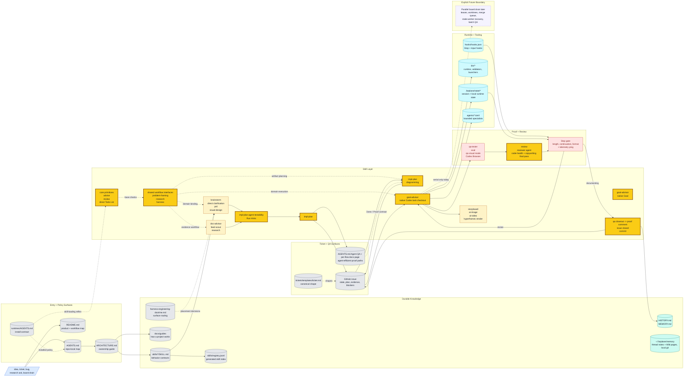

# Farplane Architecture

Active task state lives in GitHub Issues in each project's own repository
(`farplane/bindings.yaml#integrations.kanban.provider: github_issues`);
execution stays in the agent runtime. Multica is archived read-only. Files under
`tickets/` are proof, templates, migration snapshots, and legacy records.

Current-state system map for Farplane.

Use this file as the top-level architecture guide after the repo-local
[AGENTS.md](AGENTS.md). It explains
which surfaces exist, what each one owns, and where to go next.

Documentation routing starts in
[README.md](README.md). Keep this file
and README in sync whenever the public workflow, shipped capability list, or
whole-system diagram changes.

The canonical product contract is the [Farplane engine PRD](docs/prd.md). The
[guides](docs/guides/README.md) explain how a Farplane project works: project
files, the [work loop](docs/guides/work-loop.md) (morning chain, weekly review,
ticket execution), the CLI, hooks, the Wiki, reporting, and graphs. The
[Systems](#systems) table below names every live system and its owner.

## Purpose

Farplane is the cloneable harness substrate for running long-form AI work
through visible artifacts instead of hidden runtime state or transcript memory
alone. Operators clone Farplane to own their standards, skills, evals,
templates, tickets, automations, runtime adapters, Goal Packets, guardrails,
review loops, and self-improvement machinery.

Farplane Core pairs with the bunker (Farplane-UI-v2):

| Surface | Path | Owns |
| --- | --- | --- |
| Farplane Core | `Farplane/` | Harness contracts, framework files, skills, hooks, evals, templates, tickets, review, proof, graph/projection payloads, and repo memory |
| Farplane Bunker | `../Farplane-UI-v2/` | The operator's 3D office, the Convex backend, the YouTube extension, and the module CLI Core delegates `gateway`, `extension` and `resource-bank` to (the v1 Farplane-UI is archived) |
| Runtimes | `runtimes/codex`, `runtimes/claude` | Codex (default) or Claude Code, installed with `install.sh --runtime`; they run agent work and Farplane gives it a visible harness |

The UI scope split is part of the architecture contract:

- **Global harness surfaces** inspect and maintain Farplane itself: the
  bunker's Skill OS, Evals, and Telemetry screens, with Settings in the office.
- **Project/company surfaces** treat each project as an autonomous company with
  stable problems, teams, agents, board state, files, memory, evidence,
  metrics, and review loops.

The repo is organized around five concerns:

- `AGENTS.md`: project-local operating map loaded every loop
- `ARCHITECTURE.md`: top-level system map and canonical surface guide
- `docs/`: durable knowledge: PRD, guides, doctrine, history, and memory
- `tickets/`: issue templates, compact closed-issue locators, and readable
  legacy local archive history (active tasks live in GitHub Issues)
- `skills/`, `agents/`, `bin/`: reusable workflows, bounded specialists, and
  runtime helpers

## One Picture



Legend:

- `blue` = incoming operator surface
- `gray` = durable docs, skill contracts, guides, and ticket files
- `amber/yellow` = skill contracts and highlighted handoff skills
- `cyan` = runtime helpers and specialist process surfaces
- `red` = proof, review, and Stop-hook gates
- `teal` = memory/writeback
- `dashed purple` = future scale boundary, not shipped behavior

## Systems

One row per live system. The owner column names where the contract lives; read
that skill or file for detail. A skill named bare is `skills/<name>/`.

| System | What it does | Owning skills / code |
| --- | --- | --- |
| Agent Kernel | Always-loaded operating shape: autonomy, act/plan/answer mode, reading discipline, skill routing, proof expectations | `runtimes/AGENTS.md`, `AGENTS.md`, `docs/fundamentals/harness-engineering-doctrine.md`, `bin/README.md` |
| Work Loop | Turns intent into one bounded issue contract, does the work through skills, and proves completion with visible artifacts | `tickets/README.md`, `impl-plan`, `goal-advisor`, `qa`, `commit`; [work-loop guide](docs/guides/work-loop.md) |
| Horizon Loop | Recurring and long-running autonomy: Goal Packets, Company OS Daily/Weekly project memory and reports, backoff, PR watching | `goal-advisor`, `report-gen`, `pm`, `farplane/automations/` |
| Automations | Scheduled jobs (listed under [Automation ownership](#automation-ownership)); each record owns its schedule and prompt | `automation-advisor`, `farplane/automations/*.md`, `farplane/automations/steps/` |
| Proof And Review | QA evidence, review rubrics, adversarial tests and completion proof, so work is never self-certified | `qa`, `review`, `hooks/stop-gate/`, `agents/reviewer.toml` |
| Evals | Turns misses, regressions and skill behavior claims into runnable eval rows, Promptfoo skill comparisons, behavior traces and reliability verdicts | `eval` (`scripts/run_evals.py`, `scripts/run_promptfoo.py`), `harness` (owner placement), `skills/goal-advisor/references/metrics.md` (metric card) |
| Skill System | Skill packages, the Capability Map's specialist desks, templates, first-load guardrails, and registry intelligence | `harness` (`references/skill-system/`), `config/skill-workflows.toml`, `skills/registry.jsonl` (built by `bin/validators/sync_skill_registry.py`) |
| Self-Improvement And Learning | Bounded, measurable improvement campaigns over skills, ML systems or human-judged artifacts, driven by one hypothesis tree per issue | `goal-advisor` (`references/choose-next.md`, `references/loop-presets.md`), `eval`, `ml-autoresearch`, `harness` |
| Source And Sidecar | Outside signal: source scouting and media reconstruction that let Farplane adapt patterns without taking live dependencies | `feed-scout`, `intelligest`, `bookmark-recovery`, `farplane/sources/registry.jsonl` |
| Maintenance And Release | Adoption scan plus validators; a release claim cites both | `bin/core/farplane_adoption.py` (`farplane adoption scan`), `bin/validators/`, `config/template-registry.jsonl`, the shared service modules below |
| Domain Skill Families | Specialized frontend, media and content workflows built on the Work Loop and Skill System | `prd`, `visual-design`, `landing-page`, `storyboard`, `ai-image`, `ai-video`, `hyperframes` |
| Documentation | Decides where durable docs belong, how they are shaped, and which check proves them | `doc-advisor`, `review` (documentation-quality rubric), [docs/AGENTS.md](docs/AGENTS.md), `bin/validators/check_doc_refs.py` |
| Content Production | Composes an idea with an approved Brand Kit and an optional Tasty Pack into a reviewable issue-owned plan and proof trail (status: designed) | `storyboard`, `ai-image`, `ai-video`; Brand Kit storage in the bunker (`convex/modules/resourceBank/brandKits.ts`) |
| Resource Bank And Tasty Pack | Saved creative captures with selected elements, and per-request inspiration packs for production | `intelligest` (`references/resource-bank/`), `storyboard` (composition with Brand Kit), `design-styles`; storage in the bunker's Convex |
| Graph Systems | Harness graph vocabulary and GraphIR projections: skill, backlink, Framework Core and lifecycle graphs | `harness` (`graph/README.md`, `scripts/graph_ir.py`, `scripts/graph_projection.py`, `scripts/graph_projection_config.py`, `scripts/generate_*_graph.py`); [graphs guide](docs/guides/graphs.md) |
| Wiki | Project-local knowledge: Markdown entity articles, explicit entity links, and disposable search, graph, CRM and view projections | `manage-wiki`, `bin/core/farplane_wiki.py`, `bin/core/farplane_wiki_store.py`, `bin/core/farplane_entities.py`; [Wiki guide](docs/guides/wiki-and-entities.md) |

Brand Kit rules (Content Production): a Brand Kit is approved identity, made of
embedded element snapshots plus one kit prompt; it has no prompt variants,
recipe or profile tables. Constraints live in the kit prompt or policy, not as
elements; hooks and copy stay in `storyboard`, captions in editing. A Tasty Pack
augments a kit only when compatible or when the conflict is explicitly
resolved. Every output records the kit and prompt revisions and the element ids
it used.

### Shared service modules

UI routes and CLI projections read the shared payload or generated artifact and
only normalize it for display; they never recompute registry, rollout, or graph
semantics. Each interpretation lives once, in its service module:

| Module | Owns |
| --- | --- |
| `bin/validators/template_usage.py` | parsing `template_uses` |
| `bin/validators/sync_skill_registry.py` | building `skills/registry.jsonl` |
| `skills/harness/scripts/generate_template_intelligence.py` | skill and template rollout |
| `skills/harness/scripts/graph_ir.py`, `graph_projection.py`, `graph_projection_config.py` | the shared graph model |
| `bin/core/farplane_adoption.py` | project manifest drift |
| `bin/core/farplane_skill_rollout.py` | the read-only rollout payload |
| `bin/core/farplane_harness_health.py` | the harness health bundle |
| `bin/core/farplane_primitive_metrics.py`, `farplane_metric_refresh.py`, `farplane_project_snapshot.py` | metric and snapshot read models |

## Canonical Surfaces

### Documentation router

The public docs are intentionally split by job:

| Surface | Owns | Must Stay In Sync With |
| --- | --- | --- |
| [README.md](README.md) | reader routing, setup, current-state summary, roadmap cap | this file, `docs/guides/README.md` |
| [ARCHITECTURE.md](ARCHITECTURE.md) | system diagram, Systems table, surface ownership, read order, current limits | README, `docs/guides/README.md` |
| [docs/guides/README.md](docs/guides/README.md) | how a Farplane project works, one guide per concern | README, this file |
| [tickets/README.md](tickets/README.md) | ticket state machine, invocation policy, metadata contract | ticket template, `goal-advisor` skill |
| [docs/HISTORY.md](docs/HISTORY.md) / [docs/MEMORY.md](docs/MEMORY.md) | durable timeline and project invariants | closeout tickets and nearest module docs |

If a public harness claim changes, update the relevant row's surfaces in the
same pass and run:

```bash
python3 bin/validators/check_doc_parity.py
python3 bin/validators/check_harness_invariants.py
python3 tickets/scripts/check_ticket_metadata.py
```

Do not shrink or remove the colored Mermaid maps in README or ARCHITECTURE
during cleanup unless the replacement carries the same routing information.

### Entry surfaces

- [AGENTS.md](AGENTS.md)
  Purpose: project-local operating map, read-first paths, local rules
- [README.md](README.md)
  Purpose: product story, setup, and major public entrypoints
- [ARCHITECTURE.md](ARCHITECTURE.md)
  Purpose: system map, ownership boundaries, and where each concern lives

### Automation ownership

- `farplane/automations/` holds one record per live scheduled job
  (`farplane_project_automation`), tagged with the `runtime` and `runtime_task`
  that run it. Steps a job calls live in `farplane/automations/steps/`.
- Bootstrap creates an empty `farplane/automations/`; automation-advisor adds jobs
  from its templates.
- The runtime named in each automation record's `runtime:` field owns its live
  schedule (currently Claude scheduled tasks); `.farplane/` owns ignored run data.
- Skills own file-to-file business logic; automation records own integrations.

Live jobs (each record owns its schedule and prompt):

| Job | Does |
| --- | --- |
| Morning | collect, metrics refresh, knowledge update, project review, prospector watch, then one brief |
| Report Gen | weekly portfolio review |
| Intel Digest | Bookmark Recovery, then Feed Scout |
| Session Friction Retro | daily friction report, read weekly |
| Profile Refresh | operator profile refresh after the weekly report |
| Token Burn | parallel backlog jobs before the weekly usage reset |
| Thread Sweeper | two-hourly nudges to stalled threads |

### Knowledge surfaces

- [Systems](#systems)
  Purpose: one row per live system, with what it does and its owning skills
  and code
- [docs/guides/README.md](docs/guides/README.md)
  Purpose: how a Farplane project works, routed to one guide per concern
- [docs/fundamentals/harness-engineering-doctrine.md](docs/fundamentals/harness-engineering-doctrine.md)
  Purpose: routing doctrine for where harness changes belong before widening policy or adding new surfaces
- [docs/AGENTS.md](docs/AGENTS.md)
  Purpose: docs layout, the doc-or-skill test, and keep/delete rules for
  durable written state
- [skills/feed-scout/SKILL.md](skills/feed-scout/SKILL.md)
  Purpose: tracked-profile monitoring recipe for discovering X, YouTube, and
  blog content, deduping canonical URLs in a content/proposal ledger,
  scouting single sources for adopt/adapt/reject/defer verdicts, and routing
  convergent items to research synthesis
- [skills/doc-advisor/SKILL.md](skills/doc-advisor/SKILL.md)
  Purpose: doc strategy, grounded doc updates, and loss-checked consolidation
- [docs/HISTORY.md](docs/HISTORY.md)
  Purpose: append-only change log
- [docs/MEMORY.md](docs/MEMORY.md)
  Purpose: curated durable invariants and constraints
- [skills/qa/references/guide.md](skills/qa/references/guide.md)
  Purpose: QA/browser-test entry guidance and runbook policy; a project's own
  runbooks live in its `AGENTS.md` Agent QA section, plus one docs page per long flow

### Execution surfaces

- [tickets/README.md](tickets/README.md)
  Purpose: ticket lifecycle, frontmatter contract, invocation policy, and
  durable progress policy
- [tickets/templates/ticket.md](tickets/templates/ticket.md)
  Purpose: canonical compact ticket-as-program shape for task scope, delta,
  program pseudocode, map, `Done / Proof`, state, links, and optional agent
  contract/run hints for delegated or unattended work
- GitHub Issues in the project's own repository
  Purpose: active task board (see `tickets/README.md`)
- `tickets/archive-index.jsonl`
  Purpose: historical locator rows written by the retired close command and
  read by `farplane tickets history`; no new rows are added
- [tickets/archive](tickets/archive)
  Purpose: readable legacy completed or retired work history; no new terminal
  packet is created there

### Review and proof surfaces

- [skills/qa/SKILL.md](skills/qa/SKILL.md) and [hooks/stop-gate/README.md](hooks/stop-gate/README.md)
  Purpose: QA -> reviewer -> Stop-hook quality gate split
- [skills/review/README.md](skills/review/README.md)
  Purpose: public entrypoint to the review system
- [skills/review/references/rubrics/review-rubric-index.md](skills/review/references/rubrics/review-rubric-index.md)
  Purpose: canonical scoring map, thresholds, and rubric family selection

The review scoring model is canonical in `skills/review/*`, not in this file.

### Runtime and orchestration surfaces

- [docs/guides/work-loop.md](docs/guides/work-loop.md)
  Purpose: end-to-end execution model, lane roles, and orchestration boundaries
- [skills/goal-advisor/SKILL.md](skills/goal-advisor/SKILL.md)
  Purpose: canonical execution compiler that turns listed files, trigger mode,
  budget, and proof policy into native Goal, heartbeat, batch, rollout,
  feedback, or direct-route prompts
- [bin](bin)
  Purpose: hooks, validators, runtime helpers
- `.farplane/` local state
  Purpose: ignored project-local runtime, generated, event, scout, eval, and
  product state

## Ownership Boundaries

- Root docs should stay map-like.
- Detailed behavior belongs in the owning skill; how-a-project-works narrative
  belongs in `docs/guides/`.
- Active task state belongs in the project's GitHub issue and its comments,
  not in chat. Repository files may hold structured proof or migration snapshots.
- Reusable QA shortcuts and deterministic browser-entry guidance belong in
  the project's `AGENTS.md` Agent QA section (plus one docs page per long flow,
  made when the first one exists), not in ticket prose or transient chat.
- Review scoring belongs in `skills/review/*`.
- Runtime machinery belongs in `bin/`, `hooks/hooks.json`, and
  `docs/guides/hooks-and-runtime.md`.
- Reusable workflow detail belongs in `skills/*`.
- Specialist desks belong in `config/skill-workflows.toml` `[specialists]`;
  first-load loading rules belong in `skills/harness/references/skill-system/README.md`, the generated
  skill registry, and direct `SKILL.md` checklist links. The global template carries only the always-loaded
  skill-loading reflex.

## Read Order

When orienting on the repo:

1. Read [AGENTS.md](AGENTS.md).
2. Read [ARCHITECTURE.md](ARCHITECTURE.md).
3. Read [README.md](README.md) for product/setup context.
4. Read the [Systems](#systems) table, then [docs/guides/README.md](docs/guides/README.md).
5. Read [docs/fundamentals/harness-engineering-doctrine.md](docs/fundamentals/harness-engineering-doctrine.md) when the task changes the harness itself.
6. Read the active ticket and [tickets/README.md](tickets/README.md).
7. Follow links into the specific skill, guide, or runtime surface you actually need.

## Current Limits

- The architecture map is intentionally current-state-first and should not become
  a second encyclopedia.
- README is the documentation router; ARCHITECTURE is the ownership map. Update
  both together when the public harness story changes.
- Farplane has strong single-ticket orchestration and Goal-backed file-list
  execution, but not parallel N-agent board drain with leases, worktrees, merge
  policy, stale-worker recovery, and batch QA yet.
- Doc governance is hybrid by design: structural entrypoint checks are
  mechanical, while narrative drift is audited with a prompt-driven workflow.
