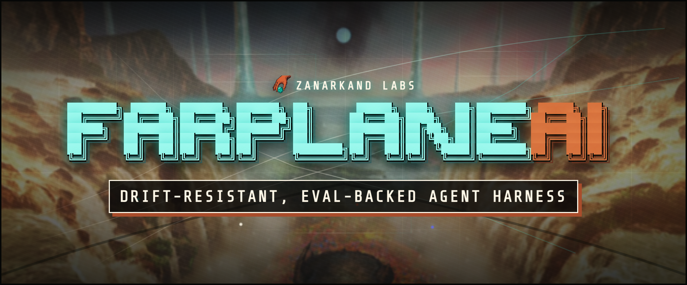
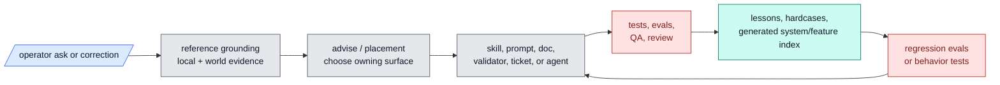

# Farplane



Farplane is a local AI operating harness for turning an operator-defined
commercial bet into one inspectable next commitment at a time.

The current product contract is [Farplane V1](docs/prd.md), implemented by the
[framework lifecycle](docs/farplane-framework/lifecycle.md) and its linked
technical contracts.

Clone this repo when you want to build and maintain your own operating harness
for AI work: standards, skills, evals, templates, tickets, automations, runtime
adapters, Goal Packets, guardrails, graph projections, review loops, and
self-improvement machinery. Farplane Core is the durable substrate; the bunker
(Farplane-UI-v2) is the cockpit that makes the substrate visible and steerable.

The product has two operating scopes:

- **Global harness scope**: inspect and maintain the harness itself, including
  skills, evals, templates, rollout, graph/lifecycle maps, runtime settings,
  and user communication surfaces.
- **Project/company scope**: treat each project as an autonomous company with
  stable problems, teams, agents, board state, files, memory, evidence,
  metrics, and review loops.

Farplane is broader than tickets. The ticket-first autonomous coding loop is
one important feature, but the larger purpose is to keep an AI harness learning
without letting it silently sprawl, forget, or self-approve weak work.

## Five Developer-Facing Differences

Farplane is for developers who want Codex or Claude Code to do serious work
without turning their repo into a haze of prompts, chat memory, and
unverifiable claims.

1. **A local control plane for agent work.** Farplane keeps plans, runtime
   state, memories, feature specs, and proof in files that developers can diff,
   review, and repair; tasks live in the project's own GitHub Issues.
2. **Objective loops that do not drift.** Project metric objectives live in
   `farplane/metrics.yaml` with explicit direction, and Core derives movement
   from raw observations. Goal Packets give selected long-running work its loop
   policy (`## Goal program`) and latest checkpoint (`## Current Goal state`) in
   the GitHub issue body, with append-only progress as issue comments, so a
   business, product, or multi-agent loop can keep a longer horizon without
   becoming one giant prompt.
3. **Completion that requires evidence.** QA, reviewer lanes, browser proof,
   maintainability review, and Done / Proof contracts make "done" inspectable
   instead of self-reported.
4. **Skills that improve like software.** Farplane skills carry checklists,
   references, examples, evals, registries, validators, and maintenance scripts,
   so repeated workflows get better without bloating the global prompt.
5. **Harness health as a product surface.** Harness Map, Skill OS, Eval OS,
   Rollout, Template Tracking, and Mighty Guard-style checks turn weak skills,
   stale docs, failing evals, drift, telemetry, nudges, and maintenance
   findings into visible operator workflows.

## Product Shape

Farplane has a simple source-of-truth split:

- **Farplane Core** is this repo. It owns harness contracts, project framework
  files, skills, evals, templates, review gates, proof contracts,
  graph/projection payloads, repo memory, and install/runtime policy.
- **The bunker** (`Farplane-UI-v2/`) is the only UI. It owns the operator's 3D
  office, the Convex backend, the YouTube extension, and the module CLI that
  Core delegates `gateway`, `extension` and `resource-bank` to. The v1
  Farplane-UI is archived.
- **Runtimes** are Codex (the default) and Claude Code. `install.sh --runtime`
  installs Farplane into either one; they run agent work, and Farplane gives
  that work a visible harness.

Farplane Core also owns the global `farplane` CLI. App-specific commands stay
with the bunker, but install, hooks, doctor checks, UI linking, UI start, and
local delegation all route through this Core-owned command.

Each project's scheduled jobs live in its committed `farplane/automations/`,
one file per live routine; the steps those jobs call live in
`farplane/automations/steps/`. See the [automation ownership contract](docs/farplane-framework/project-files.md#farplaneautomations).

Other app ideas should graduate into Core contracts, bunker modules, skill-owned
viewers, or archived experiments instead of becoming new centers of gravity.

The product rule is:

- **Core owns proof:** Farplane Core owns harness semantics, skills, hooks,
  evals, review, memory, runtime state, and Done / Proof contracts.
- **The bunker owns operation:** global harness modules, project/company views,
  the visual office, and operator settings.
- **Skill-owned UI incubation:** a skill may ship a small viewer, panel, or URL
  binding before the workflow is productized.
- **Roll-up when proven:** useful skill UIs graduate into bunker modules while
  keeping a skill binding back to the owning workflow.
- **Runtimes stay runtimes:** Codex, Claude Code, Telegram paths and external
  CLIs connect to the harness without becoming the product core.
- **State is Farplane-native:** project-local product/runtime state lives under
  `.farplane/`; global product state can live under `~/.farplane/` when the
  multi-project shell needs it.

The whole-system diagram and ownership map live in
[ARCHITECTURE.md](ARCHITECTURE.md).

## Operating Loop

Farplane turns each material request into a visible loop:

```text
ask -> ground -> choose the owner -> act -> prove -> learn
```

The global prompt stays lean; durable behavior lives in skills, feature specs, tickets,
validators, subagents, evals, and review gates. When work fails, the correction
can become a lesson, hardcase, eval row, skill update, or harness-placement
decision instead of disappearing into chat history.

## Improvement Loop



## Repo Index

| Path | Contains |
| --- | --- |
| `AGENTS.md` | Project-local operating contract for developing Farplane itself. |
| `ARCHITECTURE.md` | Deeper system map, ownership boundaries, and read order. |
| `agents/` | Bounded specialist role configs. |
| `assets/` | Repo-level media and generated assets. |
| `bin/` | The `farplane` CLI, runtime helpers, validator wrappers, launchers, and sync scripts. |
| `bin/validators/` | Testable repo-wide validators for docs, harness invariants, skills, and registries. |
| `docs/` | Systems, feature specs, generated registries, history, memory, and durable research. |
| `docs/systems/` | Authored public system docs plus generated system registry. |
| `docs/features/` | Authored first-class feature specs plus generated feature registry output. |
| `docs/fundamentals/` | Harness theory, doctrine, and cross-surface best practices. |
| `.farplane/` | Ignored project-local runtime, generated, event, and product state. |
| `.agents/skills/` | Project-local skills used only inside this repo. |
| `config/` | Farplane's own settings: skill groups and profiles, validation and git-gate checks, template registry. |
| `farplane/` | This project's committed config: harness, metrics, bindings, automations. |
| `hooks/` | Shared hook sources; `hooks/hooks.json` is the one hook registration. |
| `runtimes/` | `runtimes/AGENTS.md` (the install-time global contract shared by both runtimes) plus what `codex` and `claude` each need beyond the shared sources. |
| `skills/` | Farplane skill packages, references, scripts, and templates. |
| `tickets/` | Issue templates and the frozen legacy local archive. Active tasks live in GitHub Issues. |

## Start Here

- Install / onboarding: [Local CLI Onboarding](#local-cli-onboarding)
- Architecture map: [ARCHITECTURE.md](ARCHITECTURE.md)
- Fundamentals: [docs/fundamentals/README.md](docs/fundamentals/README.md)
- Systems stack: [docs/systems/README.md](docs/systems/README.md)
- Feature specs and registry contract: [docs/features/README.md](docs/features/README.md)
- Harness algebra: [docs/fundamentals/harness-algebra.md](docs/fundamentals/harness-algebra.md)
- Prompt engineering: [docs/fundamentals/prompt-engineering.md](docs/fundamentals/prompt-engineering.md)
- Generated system registry data: [docs/systems/registry.jsonl](docs/systems/registry.jsonl)
- Generated feature registry data: [docs/features/registry.jsonl](docs/features/registry.jsonl)
- Skill guide: [docs/skills/README.md](docs/skills/README.md)
- Skill best practices: [docs/skills/best-practices.md](docs/skills/best-practices.md)
- Ticket and Goal contract (GitHub Issues, close rule, `## Goal program`): [tickets/README.md](tickets/README.md#current-github-issues-workflow)
- Goal Packet skill: [skills/goal-advisor/SKILL.md](skills/goal-advisor/SKILL.md)
- QA guide: [skills/qa/references/guide.md](skills/qa/references/guide.md)
- Review scoring: [skills/review/README.md](skills/review/README.md)
- Code health (debug, clean, review, harden, audit): [skills/code-health/SKILL.md](skills/code-health/SKILL.md)
- Active queue: GitHub Issues in each project's own repo.

## Local CLI Onboarding

Use this path when Farplane Core is already installed locally and you want to
attach the optional bunker checkout (Farplane-UI-v2).

```bash
cd /path/to/Farplane
bash install.sh                    # Codex; add --runtime claude for Claude Code
farplane doctor
farplane hooks list --json
farplane hooks doctor
farplane ui link /path/to/Farplane-UI-v2
farplane ui start
```

What Core owns:

- `farplane doctor`: reports readiness for Core install, hooks, linked UI repo,
  local config hygiene, and this checkout's Doppler secret source.
- `farplane install`: performs safe mechanical install/reinstall work: renders
  Codex config, retains local `desktop` and `plugins.*` tables in
  `config.local.toml`, regenerates role skill profiles, links hooks, and
  refreshes the global CLI link. In this checkout it automatically runs the
  installer subprocess through Doppler when Doppler is configured and the
  current shell is not already Doppler-injected.
- `farplane hooks install`: refreshes the hook install through Core.
- `farplane hooks list`: inventories every managed Core hook command.
- `farplane hooks doctor`: verifies Core-owned hook links, command targets,
  interpreters, and known silent-skip regressions without requiring optional
  bunker/Node telemetry.
- `farplane desk <desk> --runtime codex|claude`: launches Codex or Claude as one
  Capability Map desk with only its skills and helpers.
- `farplane notify status|enable|disable`: inspects or toggles the Farplane
  turn-complete notify script in the rendered global Codex config, preserving
  desktop notify wrappers and the selected setting across later installs. A
  runtime guard also silences callbacks retained by already-running threads.
- `farplane run -- <command>`: runs a command through the current project's
  Doppler secret environment.
- `farplane eval init`: writes this project's non-secret Promptfoo/Codex
  comparison profile at `.farplane/evals/promptfoo-profile.json`.
- `farplane eval promptfoo --skill <name> --label <label>`: runs the owning
  Agent Skills manifest through Promptfoo, compares it with the clean baseline,
  and publishes the receipt to this project's Farplane Office Eval OS runs.
- `farplane metrics primitives --project-root /path/to/project --date YYYY-MM-DD --json`:
  refreshes Core primitive readings for ticket/KPI/product counts, Codex thread
  usage, burn source gaps, and ticket/thread association backfill.
- `farplane project snapshot --project-root /path/to/project --json`: writes a
  read-only project/company projection for the bunker and Company OS context.
- `farplane skills rollout scan --json`: emits a read-only skill rollout
  projection for the bunker and local status checks.
- `farplane capability-profiles read --project-root <path>`: resolves the
  optional, runtime-portable Project PM skill/MCP allowlist.
- `farplane ui link /path/to/Farplane-UI-v2`: stores the bunker checkout in
  `~/.farplane/farplane-cli.json`.
- `farplane ui start`: starts the linked bunker (`npm run dev:bunker`).
- `farplane gateway ...`, `farplane resource-bank ...` and `farplane extension
  youtube ...`: delegate to the bunker checkout's module CLI.

Farplane consumes runtime secrets as environment variables first. This checkout
uses Doppler for local secret injection, so credentialed scripts should run
through `farplane run -- <command>` or `doppler run -- <command>`. `farplane
run` uses the current working directory's Doppler setup, which lets scripts live
under `skills/` while secrets come from the project scope. Farplane does not
store Doppler tokens in the repo. Private `~/.farplane/config.toml` stores
non-secret UI-managed machine/operator settings only; Core ignores credential
fields there and `farplane doctor` reports their names for migration. See
[secret management](docs/fundamentals/secret-management.md).
`runtimes/codex/config.toml.example` still renders the installed `~/.codex/config.toml`, but
that file is a Codex adapter output and the lowest-priority fallback, not the
Farplane source of truth.

The command grammar is intentionally small: `doctor` reports readiness,
`install` applies safe mechanical repair/render/link behavior, and
`run -- <command>` executes arbitrary credentialed commands.

Keep tracked project coordinates such as URLs, aliases, safe IDs, and metric
recipes in `farplane/bindings.yaml`. Keep API keys, tokens, passwords, OAuth
credentials, and webhook secrets in Doppler-injected runtime env only.

Override the linked UI checkout for one shell with `FARPLANE_UI_REPO=/path/to/Farplane-UI-v2`.
Use `FARPLANE_CLI_LINK_DIR=/custom/bin bash install.sh` if your preferred
global executable directory is not `~/.local/bin`.

## Current Boundary

Farplane is installed into normal Codex or Claude Code and uses visible repo
artifacts and GitHub Issues as the control plane. Tasks close by a proof comment
and `gh issue close` (see [tickets/README.md](tickets/README.md)). It is not a hidden daemon, hosted scheduler, or parallel
multi-agent dispatcher today. Background hooks for live skill-health benchmarks
and saved disliked-case feedback loops are planned harness surfaces, not fully
shipped behavior yet.

Offline evals and human-marked failure capture are the shipped improvement
primitives today. Broader live skill-health benchmarks remain future work.
