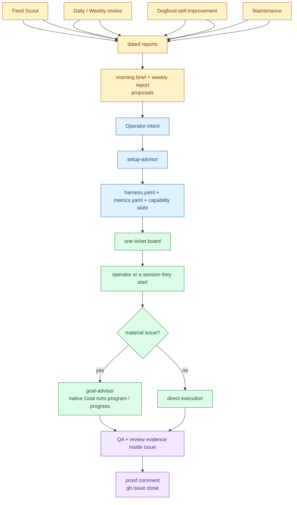

# Farplane Lifecycle

Farplane V1 is an operating system for moving an operator-chosen commercial bet
toward money. Its center is deliberately small. Active Daily and Weekly use the
Company OS file-in/file-out boundary owned by `report-gen` (`daily` and `weekly`
modes) and the AI Office `farplane/automations/`; Interval is legacy reference only.

```text
project(commercial intent, execution, evidence)
  -> typed commercial hypothesis + selected money outcome + hard guards
  -> one ticket board
  -> Daily/Weekly maintains project memory and reviews money-linked movement
  -> the operator, or a session they start, runs goal-advisor on an issue
     (native Goal); small work runs directly
  -> scheduled sources add reports and context
  -> ticket programs, progress, QA, and review preserve proof
  -> durable outcomes flow back to docs, metric objectives, and skills
```

Files carry durable state, skills carry reusable workflows, tickets carry work
contracts, and native Codex Goals carry material continuation. A capability
skill may produce an important recurring artifact, but it does not receive its
own planner, worker pool, strategy file, or heartbeat.

## Quick Start

1. Run `setup-advisor` to create or migrate the project substrate.
2. Read `farplane/harness.yaml` for identity, the `planning.skill_refs`
   allowlist, passive area context, authority, and selected objectives/guards.
3. Read `farplane/metrics.yaml` for metric meaning, direction, freshness, and
   guard rules; read generated observations for current values.
4. Read the ticket board for executable commitments and proof.
5. Use the `goal-advisor` metric card (`references/metrics.md`) when the objective, direction, guard, or proof
   provider needs a material change.
6. Use `goal-advisor` when a selected material ticket needs a Goal Packet.
7. Start execution by running `goal-advisor` on a ready issue (native Goal), or
   run small work directly. There is no execution heartbeat. Scheduled jobs in
   `farplane/automations/` (the Morning chain, the weekly `report-gen` review,
   and the rest) are cron records that collect, report and propose.

The deeper bootstrap path is [Setup Advisor Critical Path](setup-advisor-critical-path.md).
The file-by-file reference is [Project Files](project-files.md).

## Lifecycle Map



## The Minimal Work Loop

```text
work(issue)
  -> goal-advisor(issue) -> native Goal executes the issue's Goal program   # material
   | direct execution                                                       # small
  -> one proof comment + gh issue close
```

There is no execution heartbeat. Work Pulse, the former heartbeat, is retired
([FEAT-0071](../features/FEAT-0071-project-work-pulse.md)); no dispatch loop
admits, refills, or resumes issues. Work enters as a GitHub issue in the
project's own repository. Execution starts when the operator, or a session they
start, runs `goal-advisor` on the issue (native Goal); small work runs
directly. `goal-advisor` may call capability skills when the issue needs them.

## Scheduled Sources

Scheduled automations are cron records that collect, report and propose. They
are not heartbeats or worker authorities: they never create, close, label,
assign or edit issues and never start agents or runs.

| Source | Reads | Writes | Ticket authority |
| --- | --- | --- | --- |
| Feed Scout | configured feeds and prior source reports | source report + candidates | none; candidates reach the operator through reports |
| Daily / Weekly review | project memory, project configuration, configured metrics, and bounded evidence | current project memory, targeted follow-ups, weekly reports, and operator-visible work proposals | none beyond authorized `gh issue comment` on existing issues; new work stays a proposal for the operator |
| Dogfood | active and recent archived experiments plus prior report | portfolio learning report + experiment candidates | none; self-improvement competes globally |
| Maintenance | registries, docs, skills, validators | maintenance report + repair candidates | none unless directly invoked by the operator |

Daily and Weekly do not invent direction, fake momentum, or execute work. Feed Scout and Dogfood do not materialize their candidates.
A candidate becomes work only when the operator, or a session they start, opens
a GitHub issue for it.

A GitHub issue closes by the close rule in `tickets/README.md`: one proof
comment, then `gh issue close <n> --reason completed`; local supporting files
stay. Farplane Stop hooks collect telemetry and may apply bounded deterministic
guards such as final-response length; they do not repair proof, advance
closeout, or close issues. Closing emits no completion event and starts no
mining: the closing session routes lessons to their owner, and the daily
`report-gen` automation reads issues closed since its last run.

Existing `tickets/archive/TASK-*` packets and `tickets/archive-index.jsonl`
rows remain readable legacy records and are not migrated.

## Goal Packets And Check-Ins

Material or resumable work uses:

```text
GitHub issue <n>
  body: ticket sections   # scope, Reward, Done / Proof, QA/review contract
  body: ## Goal program   # loop, budgets, stop rules, executable Check-In Program
  body: ## Current Goal state   # latest checkpoint, rewritten each turn
  Goal turn comments      # append-only observations and decisions
  linked artifacts        # implementation, QA, review, and supporting evidence
```

Due check-ins are open issues labelled `check-in` with a `Due: YYYY-MM-DD`
line. Daily Collect (`farplane/automations/steps/daily-collect.md`) lists them
and the morning brief surfaces them; the operator, or a session they start,
resumes that Goal with `goal-advisor`'s Delayed Check-In Resume prompt. The
resumed Goal reads `## Goal program` first and executes its `Check-In Program`.
It updates only matured rows and decides `accept | kill | monitor` as
the program permits. Future rows remain dormant. No automation resumes,
dispatches, or scores a check-in.

## State Ownership

| State | Durable owner |
| --- | --- |
| Identity, stable problems, planning areas/instructions, constraints, authority, capabilities, selected metric refs | `farplane/harness.yaml` |
| Metric meaning, required direction, freshness, guard rules, and raw-observation interpretation | `farplane/metrics.yaml` |
| Recurring workflow | reusable `skills/*` or project-local `.agents/skills/*` |
| Executable commitment and all QA/review evidence | owning GitHub issue and linked artifacts |
| Goal/check-in loop policy | issue body `## Goal program` |
| Append-only task or experiment observations | Goal turn comments on the issue |
| Closed-ticket identity and archive location | the closed GitHub issue and its proof comment; `tickets/archive-index.jsonl` holds historical locator rows from the retired close command, read by `farplane tickets history`; no new rows are written; `tickets/archive/TASK-*` for readable legacy archives |
| Global Company OS Daily/Weekly prompts | AI Office `farplane/automations/` |
| Project-local automation topology and prompts | project `farplane/automations/` |
| Provider coordinates | `farplane/bindings.yaml` |
| Runtime receipts and derived context | `.farplane/reports/**` and other generated `.farplane/**` projections |

Reports help the next reader plan. Daily and Weekly reports and project memory
may produce operator-visible work proposals, but they do not admit tickets or
become executable state. Work starts only when the operator, or a session they
start, runs `goal-advisor` on an issue or does small work directly.
Generated indexes are projections over these owners, not hand-maintained
strategy ledgers.

## Capability Skills

Important recurring outputs should have callable skills:

```text
capability_skill(ticket, metric_objectives, current_context)
  -> artifact + evidence + ticket_state_delta
```

Use a root `skills/<name>/` package when the workflow is reusable across
projects. Use `.agents/skills/<name>/` when it is company- or project-specific.
Promote only after repeated evidence. A skill owns how to produce the artifact;
`harness.yaml` selects the measurable contribution; the ticket owns the current commitment and
proof.

## Minimum Autonomous Instruction Set

A project needs:

- `farplane/harness.yaml` with identity, planning areas/instructions, stable policy, authority,
  capability refs, and selected metric refs;
- `farplane/metrics.yaml` with definitions, direction, freshness, and guard
  rules for every referenced metric;
- `farplane/automations/` with cron records that collect, report and propose
  (no execution heartbeat);
- `farplane/bindings.yaml` for non-secret provider coordinates;
- reusable or project-local capability skills for recurring workflows;
- tickets with Reward, Done / Proof, and ticket-owned QA/review evidence;
- dated reports as derived context.

If required context is missing, write a source gap, planning request, or
bounded instrumentation ticket instead of guessing or rebuilding a controller
layer.

## Durable Learning

Closeout and scheduled maintenance compress useful outcomes back to the
smallest owner:

- measurement evidence can propose a `metrics.yaml` definition or
  `harness.yaml` selection delta;
- stable policy evidence can propose a human-reviewed `harness.yaml` delta;
- repeated workflow evidence can harden or refine the owning skill;
- unresolved executable work remains a ticket;
- raw run detail stays in local artifacts or dated reports; the closing proof
  comment carries the problem, solution, verification, screenshots, and demo
  video, and local supporting files stay.

This preserves the Goal program and Goal turn comments without turning every observation into a
new schema or global ledger.
