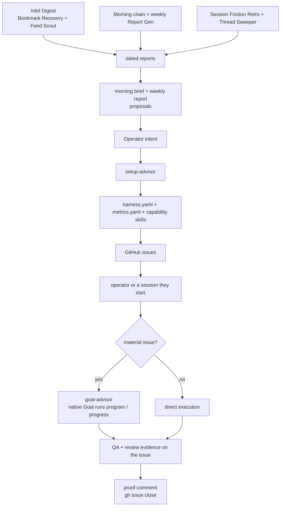

# Work Loop

How work moves through a Farplane project: how it enters as a GitHub issue,
how `goal-advisor` turns it into a run, how check-ins resume it, what the
scheduled jobs do around it, and how it completes.

```text
Operator intent -> setup-advisor -> harness.yaml + metrics.yaml + skills
  -> GitHub issues in the project's own repository
  -> goal-advisor (material) | direct execution (small)
  -> QA + review evidence on the issue
  -> one proof comment + gh issue close

Scheduled sources -> dated reports -> morning brief + weekly proposals -> operator
```

Files carry durable state, skills carry reusable workflows, issues carry work
contracts, and the runtime's native Goal (`/goal`, in Codex or Claude Code)
carries material continuation. The Farplane engine moves an operator-chosen
commercial bet toward money; its center stays deliberately small.



## Quick Start

1. Run `setup-advisor` to create or migrate the project substrate
   ([critical path](../../skills/setup-advisor/references/critical-path.md)).
2. Read `farplane/harness.yaml` for identity, the `planning.skill_refs`
   allowlist, passive area context, authority, and selected objectives/guards.
3. Read `farplane/metrics.yaml` for metric meaning, direction, freshness, and
   guard rules; read generated observations for current values.
4. Read the project's open GitHub issues for executable commitments and proof.
5. Use the `goal-advisor` metric card (`references/metrics.md`) when the
   objective, direction, guard, or proof provider needs a material change.
6. Use `goal-advisor` when a selected material issue needs a Goal Packet.
7. Start execution by running `goal-advisor` on a ready issue (native Goal), or
   run small work directly.

The file-by-file reference is [Project Files](project-files.md).

## How Work Enters

There is no execution heartbeat. Work Pulse, the former heartbeat, was retired
on 2026-10-12 (#41); no dispatch loop admits, refills, or resumes issues.

```text
work(issue)
  -> goal-advisor(issue) -> native Goal executes the issue's Goal program   # material
   | direct execution                                                       # small
  -> one proof comment + gh issue close
```

Work enters as a GitHub issue in the project's own repository
([tickets/README.md](../../tickets/README.md) owns the issue mechanics).
Execution starts when the operator, or a session they start, runs
`goal-advisor` on the issue; small work runs directly. `goal-advisor` may call
capability skills when the issue needs them. A candidate from a report becomes
work only when the operator, or a session they start, opens an issue for it.

Autonomous execution starts only when one of these is true:

- the work is tiny, reversible, and directly requested, so no issue is needed;
- an accepted issue or controlling spec already owns the scope;
- an `impl-plan` plan has passed its self-check and reviewer gate; or
- a Goal Packet has been approved or explicitly pre-approved for execution.

Inside a Goal Packet, the executor tries to land the whole selected issue. It
does not shrink the issue into a safer internal slice unless the issue, proof
route, safety boundary, external dependency, or reviewer finding creates a
real split.

## From Idea To Closed Issue

The path from a human-shaped idea to a reviewed, completed artifact splits
human judgment, durable planning, autonomous execution, and independent proof:

```text
shape intent (brainstorm / advise / prd; gate: material choices explicit)
  -> bind work (issue with Summary, Scope, Delta)
  -> impl-plan (Change Plan, Done, QA Strategy; gate: reviewer pass)
  -> goal-advisor (gate: packet approved)
  -> native Goal
  -> qa proof
  -> reviewer TAS verdict
  -> proof comment + gh issue close + docs/memory writeback
```

The human conversation comes first while the direction is still a product,
workflow, architecture, prompt, or harness choice. `problem-framing`,
`brainstorm`, `advise` with `ensemble=auto|max`, `prd`, `impl-plan`, direct
clarification, or a direct operator decision turns fuzzy intent into an
accepted direction. Once accepted, the issue becomes the task-local source of
truth and execution can become autonomous inside that scope.

| Phase | Primary owner | Issue section or artifact filled | Gate before next phase |
| --- | --- | --- | --- |
| Shape intent | human + `brainstorm` / `advise` / `prd` | accepted direction, examples, rejected options | material choices are explicit |
| Bind work | issue author / `impl-plan` | `Summary`, `Scope`, initial `Delta`, dependencies | issue exists and scope is coherent |
| Plan implementation | `impl-plan` | `architecture_signatures`, `Change Plan`, `Done`, `QA Strategy`, `Docs Strategy`, reviewer handoff | Todo List assertions and plan reviewer pass |
| Compile execution | `goal-advisor` | `## Goal program`, a `**Goal launcher**` comment holding the native `/goal` prompt, `## Current Goal state` | packet approved or explicitly pre-approved |
| Execute | native Goal | changed files, Goal turn comments, command evidence | issue `Done` and `QA Strategy` satisfied |
| Prove | `qa` (functional, visual, adversarial), tests, or scripts | artifacts linked from the issue | proof route matches the issue's claim |
| Review | native `reviewer` lane / `review` rubrics | review receipt linked from the issue and its Goal turn comments | required TAS gates pass |
| Close | coordinating lane (close rule in `tickets/README.md`) | proof comment, links, docs and memory writeback, residual risk | no required proof or review missing |

### How the issue fills up

The issue stays compact but becomes more executable as it moves through the
loop:

- `Summary` and `Scope` start from the accepted human direction: what is in,
  what is out, and why the issue is the right unit.
- `Delta` explains the before/after and first-principles basis, readable
  without studying implementation details.
- `Change Plan` is filled by `impl-plan`. Material coding issues start with
  `architecture_signatures`: module-level seams, main-flow signatures, relevant
  typed data movement, and the builder-owned freeform boundary. Per-change
  `signature_or_type_impact` records only local deltas.
- `Done` is the completion scoreboard: what must be true, not every command
  needed to prove it.
- `QA Strategy` names proof weight, concrete checks, delegated lanes, reviewer
  rubrics/TAS gates, evidence paths, `goal_advisor_inputs`, final evidence,
  final checkpoint, and residual risk.
- `Docs Strategy` says whether durable docs change and how that is validated.
- `Links` connect artifacts, review receipts, the local hypothesis tree when
  present, and source refs.
- `Notes` carry blast radius, rollback, blockers, follow-ups, and compact
  citations when they clarify execution.

### Goal Packets

Material or resumable work uses one issue as its packet:

```text
GitHub issue <n>
  body: ticket sections         # scope, Reward, Done / Proof, QA/review contract
  body: ## Goal program         # loop, budgets, stop rules, executable Check-In Program
  body: ## Current Goal state   # latest checkpoint, rewritten each turn
  Goal turn comments            # append-only observations and decisions
  linked artifacts              # implementation, QA, review, and supporting evidence
```

Each concern has one durable owner:

```text
ticket sections       = desired end state + scope + constraints + Done / Proof
skill                 = domain procedure + detailed evaluation logic
## Goal program       = budget + continuation + drift + stopping + optional optimization roadmap
Goal turn comments    = observations + evidence links + learned constraints + next action
## Current Goal state = latest checkpoint only
Goal prompt           = compact pointer to the issue
```

`## Goal program` starts after plan approval. It does not repeat the ticket
sections; it records loop shape, trigger, budget, metric or feedback provider,
proof policy, drift policy, stop conditions, and batch rules when relevant.
Goal turn comments are append-only observed state: what changed, what was
verified, what review said, what remains blocked, and the next action.

Every continuation follows one cycle:

```text
read state
  -> choose one bounded move
  -> act
  -> evaluate with the provider declared by the issue or skill
  -> append the observation, evidence, learning, and next action
  -> drift-check when required
  -> continue | complete | block
```

Evaluation is a distinct step, not another name for choosing what to do next.
The issue or domain skill owns what counts as evidence and how to interpret
it; `## Goal program` only binds that evaluator into the loop. For
optimization Goals, promising candidates stay in the program's roadmap or
frontier until evidence rejects them. Goal turn comments record the selected
move, rejected alternatives when relevant, learned constraints, evidence
links, and the current `next_action`; selecting one move does not silently
discard the rest.

A lean `## Goal program` fills the template sections without repeating the
ticket. Its after-turn and stopping instructions can be this compact:

```markdown
### After Each Turn

- Re-read the issue body and the newest Goal turn comments within 80 lines.
- Choose the largest unresolved acceptance, evidence, or blocker gap. For an
  optimization loop, select from the program roadmap or frontier using current
  progress learnings.
- Execute one bounded move, run the evaluator declared by the issue or active
  skill, post one Goal turn comment with the observation, evidence, learning,
  and next action, and rewrite `## Current Goal state`.
- Use `goal-drift-reviewer` before a material replan or completion.

### Stop Conditions

- `blocked_when:` Report attempted paths, strongest evidence, remaining work, and
  the exact input or contract change that would unlock progress.
```

Still fill the template's Goal Mode, budget, Metric Provider, Proof Policy,
drift, check-in, batch, or rollout sections when they apply. The launcher stays
small because it is not the durable contract: use the
[Native Goal Prompt](../../skills/goal-advisor/references/prompt-templates.md#native-goal-prompt)
for its sections, never a hand-written sectionless `/goal` line.
`best_so_far` is useful only for optimization campaigns whose candidates can
be compared; ordinary feature work records completed proof and the remaining
`next_action`.

### Evaluation by Goal shape

The cycle stays constant while the evaluation provider changes.
`ml_autoresearch` is an allowed Goal Mode instantiated through its skill-owned
preset; `delayed_reward` belongs under the Check-In Program, not the top-level
mode field.

| Shape or program submode | Evaluation after a move | What feeds the next action |
| --- | --- | --- |
| Active issue Goal | issue `Done / Proof`, tests, QA evidence, and required review | unresolved in-scope gaps |
| Skill improvement | frozen skill eval plus agent-behavior QA when declared | ranked prompt, workflow, or harness interventions |
| ML autoresearch | frozen metric evaluator; diagnose surprising or invalid results before trusting them | ranked experiment techniques and learned constraints |
| Feedback loop | structured human verdict and next instruction | remaining revisions implied by accepted feedback |
| Board-drain heartbeat (operator-started only; no automation starts one) | eligibility and current-state check; choose `start_goal`, `resume_goal`, `replan`, `blocked`, or `no_op` | the next proceedable issue or unblock action |
| Delayed-reward check-in | matured external evidence against the declared acceptance rule | `accept`, `kill`, or continue monitoring |
| Batch Goal | each issue's own proof contract, plus integration proof when required | remaining proceedable issues |
| Rollout policy | sample or batch evidence against promotion and rollback rules | promote, repair, roll back, or run the next batch |

Experiment receipts, surprise handling, feedback schemas, and rollout rules stay
in their owning skill or issue
([goal shapes](../../skills/goal-advisor/references/goal-shapes.md)); the
generic program references them rather than copying them.

### Skills that cooperate

Each skill owns a different failure boundary:

- `problem-framing` splits the symptom from the real problem, `brainstorm`
  widens fuzzy directions, and `recap-idea` plays the idea back for correction
  before it becomes an issue.
- `advise` chooses among real options and preserves the accepted tradeoff;
  `ensemble=auto|max` adds independent local personas only when requested.
- `prd` or `impl-plan` turns accepted product or system intent into
  issue-sized work; `impl-plan` turns one selected material coding issue into
  an executable plan, architecture signatures, QA Strategy, and reviewer
  handoff.
- `goal-advisor` compiles approved issue state into a visible Goal Packet and a
  compact native `/goal` prompt.
- `qa` (functional, visual, adversarial), tests, scripts, and demos collect
  proof according to the issue's `QA Strategy`.
- `review` defines TAS semantics and rubric families; the native `reviewer`
  lane supplies independent judgment and writes or returns receipts.
- `harness` maintain mode, `doc-advisor`, and `manage-wiki` handle
  owner-correct writeback after proof exists: reusable procedures become
  skills, project knowledge becomes project docs, and sourced entities become
  Wiki articles.

Todo List `Rule`/`Assert` blocks are self/preflight/repair guardrails, not
acceptance forms. The typed `reviewer` lane owns independent pass/revise/block
judgment; the typed `qa-tester` lane owns runtime, browser, UI, and proof
capture. Tiny local checks can stay inline, but material plans, skill changes,
prompts, evidence bundles, and completion claims do not self-approve when a
reviewer lane is available. When completion needs both proof and judgment, run
them in parallel when possible, and use the typed agents rather than generic
subagents:

```text
material_completion(issue)
  -> qa-tester(issue, proof_targets) -> evidence_bundle
  -> reviewer(issue, checklist?, evidence_bundle?, rubrics) -> TAS verdict
  -> coordinator reconciles both receipts before pass/revise/block
  -> proof comment + gh issue close <n> --reason completed on pass
```

## Check-Ins

Due check-ins are open issues labelled `check-in` with a `Due: YYYY-MM-DD`
line. Daily Collect (`farplane/automations/steps/daily-collect.md`) records
them and the morning brief surfaces due and overdue ones. The operator, or a
session they start, resumes that Goal with `goal-advisor`'s Delayed Check-In
Resume prompt. The resumed Goal reads `## Goal program` first and executes its
`Check-In Program`: it updates only matured rows and decides
`accept | kill | monitor` as the program permits. Future rows stay dormant. No
automation resumes, dispatches, or scores a check-in.

## Scheduled Jobs

Scheduled jobs are cron records in `farplane/automations/`, one file per live
routine, run as Claude scheduled tasks (`runtime: claude`, `runtime_task`).
The steps they call live in `farplane/automations/steps/` and are never
scheduled on their own. Jobs collect, report and propose; they are not
heartbeats or worker authorities. They never create, close, label, assign or
edit issues and never start new work. Two bounded exceptions are written into
their records: Thread Sweeper sends a nudge message to an existing agent
thread that stalled mid-work, and the Morning chain's Prospector Watch step
may spend within its floor's `budget_usd` while the week's logged spend stays
under the cap.

Farplane's own `farplane/automations/` holds the portfolio Morning and weekly
records. Each managed repository is an ordinary project with a thin `farplane/`
adapter; it does not receive another copy of those portfolio reviews.

| Record | Purpose | Main result | Issue authority |
| --- | --- | --- | --- |
| [Morning](../../farplane/automations/morning.md) | Daily collect, metrics, knowledge, Project review, and Prospector Watch, then the brief | Dated run, Project Memory, morning brief | authorized `gh issue comment` on existing issues only |
| [Report Gen](../../farplane/automations/report-gen.md) | Weekly: compare the full Project portfolio and carry next-week commitments | Project and company reports, next-week memory, operator-visible proposals | authorized `gh issue comment` on existing issues only |
| [Intel Digest](../../farplane/automations/intel-digest.md) | Run [Bookmark Recovery](../../farplane/automations/steps/bookmark-recovery.md), then [Feed Scout](../../farplane/automations/steps/feed-scout.md) | Bookmark candidate inbox, dated Feed Scout report and Scout Brief | none; candidates reach the operator through reports |
| [Session Friction Retro](../../farplane/automations/session-friction-retro.md) | Review the day's agent sessions for agent and operator friction | Dated friction report, read by the weekly review | none |
| [Profile Refresh](../../farplane/automations/profile-refresh.md) | Refresh the operator profile after the weekly report | Updated operator profile | none |
| [Token Burn](../../farplane/automations/token-burn.md) | Use leftover usage before the weekly reset | Local-only commits and a dated report | none |
| [Thread Sweeper](../../farplane/automations/thread-sweeper.md) | Every 2 hours in waking hours, find agent threads that went quiet unfinished | Nudges to stalled threads, one Telegram list of what waits on Kenji, dated report | none |

The linked records own the exact schedule and prompt.

### Morning

[Morning](../../farplane/automations/morning.md) runs its steps in order in one
session; the record owns the exact chain:

1. [Daily Collect](../../farplane/automations/steps/daily-collect.md) fetches
   GitHub issues, Git, the operator plan, call notes, and agent-session indexes
   once and freezes them as a dated run.
2. [Metrics Refresh](../../farplane/automations/steps/metrics-refresh.md)
   refreshes every registered Project's metric readings.
3. [Knowledge Update](../../farplane/automations/steps/knowledge-update.md)
   turns the run's call notes into local Wiki pages.
4. [Daily Operating Update](../../farplane/automations/steps/daily-operating-update.md)
   calls `report-gen` in `daily` mode once per eligible Project. The skill reads
   project-local Farplane configuration and evidence, then emits one JSON
   extraction describing the operator-defined commercial bet and next
   monetization event; observed result movement, with unknowns kept unknown;
   the constraint closest to that event; and one smallest useful commitment
   against existing authorized work. The automation validates the extraction,
   updates the existing Project Memory section, applies any authorized
   existing-issue comment, and reads the result back. It does not create or
   execute work.
5. [Prospector Watch](../../farplane/automations/steps/prospector-watch.md)
   runs for each floor with a `prospect_watch` block, inside its budget.
6. The morning brief reads the run, metric, Wiki, and Project Memory changes and
   due check-ins, and writes one private brief.

### Weekly Report Gen

[Report Gen](../../farplane/automations/report-gen.md) freezes a complete
Project inventory and the full week of Project Memory, then calls `report-gen`
once over that set. Missing Project coverage blocks effects. The automation
validates and renders the Project and company reports, folds in the week's
Session Friction Retro reports, applies authorized comments on existing issues,
and reads back every effect.

### Automation and skill boundary

```text
provider reads + pagination + caching        -> automation
commercial interpretation + next commitment -> report-gen skill
rendering + stale-write guard + effects      -> automation
issue execution                              -> operator or session via goal-advisor
```

The automation owns provider access, collection, frozen input files,
validation, rendering, external effects, and readback. Its skill interprets
those files and writes one structured result file. This matters when the same
judgment could be rerun on frozen evidence, audited, or safely withheld from
provider effects; it does not require a new skill for every small
deterministic mapping. PM skills have no provider access and emit one
structured local result.

Daily and Weekly may comment on authorized existing issues. They cannot create,
close, label, assign or edit issues, start agents or runs, invent strategy or
direction, fake momentum, broadly promote knowledge, contact external parties,
spend money, deploy, or perform destructive actions. Feed Scout and Bookmark
Recovery do not materialize their candidates.

The former Interval skill, weekly draft, promotion machinery, and recovery
admission path are deleted. Reusable metric reading lives in
`bin/core/farplane_metric_refresh.py`, a deterministic helper rather than a
separate operating loop.

Conversation-to-Work alignment is an unimplemented PM evidence source. A first
slice would match accessible conversations to exact Projects and Work using
supported identifiers, record coverage and unmatched conversations, and
distinguish discussion, decision, deliverable, and verified result. Daily could
surface consequential drift against the current commitment; Weekly could
summarize repeated allocation patterns across the complete Project set.
Message volume and elapsed chat time alone do not prove progress or wasted
effort.

## Completion

An issue closes by the close rule in `tickets/README.md`: one proof comment,
then `gh issue close <n> --reason completed`; local supporting files stay.
Farplane Stop hooks collect telemetry and apply bounded deterministic guards
such as final-response length; they do not repair proof, advance closeout, or
close issues. Closing emits no completion event and starts no mining: the
closing session routes lessons to their owner, and the daily `report-gen`
automation reads issues closed since its last run.

Closeout and scheduled maintenance compress useful outcomes to the smallest
owner:

- measurement evidence proposes a `metrics.yaml` definition or `harness.yaml`
  selection delta;
- stable policy evidence proposes a human-reviewed `harness.yaml` delta;
- repeated workflow evidence hardens or refines the owning skill;
- unresolved executable work stays an issue;
- raw run detail stays in local artifacts or dated reports; the closing proof
  comment carries the problem, solution, verification, screenshots, and demo
  video.

This preserves the Goal program and Goal turn comments without turning every
observation into a new schema or global ledger. Existing
`tickets/archive/TASK-*` packets and `tickets/archive-index.jsonl` rows remain
readable legacy records and are not migrated.

## State Ownership

| State | Durable owner |
| --- | --- |
| Identity, stable problems, planning areas/instructions, constraints, authority, capabilities, selected metric refs | `farplane/harness.yaml` |
| Metric meaning, required direction, freshness, guard rules, and raw-observation interpretation | `farplane/metrics.yaml` |
| Recurring workflow | reusable `skills/*` or project-local `.agents/skills/*` |
| Executable commitment and all QA/review evidence | owning GitHub issue and linked artifacts |
| Goal/check-in loop policy | issue body `## Goal program` |
| Append-only task or experiment observations | Goal turn comments on the issue |
| Closed-work identity and archive location | the closed GitHub issue and its proof comment; `tickets/archive-index.jsonl` holds historical locator rows read by `farplane tickets history` (no new rows are written); `tickets/archive/TASK-*` for readable legacy archives |
| Portfolio Morning and weekly prompts | AI Office `farplane/automations/` |
| Project-local automation topology and prompts | project `farplane/automations/` |
| Provider coordinates | `farplane/bindings.yaml` |
| Runtime receipts and derived context | `.farplane/reports/**` and other generated `.farplane/**` projections |

Reports and proposals help the next reader plan but never admit work or become
executable state. Generated indexes are projections over their owners, never
hand-maintained strategy ledgers.

## Capability Skills

Important recurring outputs get callable skills:

```text
capability_skill(issue, metric_objectives, current_context)
  -> artifact + evidence + issue_state_delta
```

Use a root `skills/<name>/` package when the workflow is reusable across
projects, and `.agents/skills/<name>/` when it is company- or project-specific.
Promote only after repeated evidence. A skill owns how to produce a recurring
artifact; `harness.yaml` selects its measurable contribution; the issue owns
the current commitment and proof. A capability skill never gets its own
planner, worker pool, strategy file, or heartbeat.

A project needs:

- `farplane/harness.yaml` with identity, planning areas/instructions, stable
  policy, authority, capability refs, and selected metric refs;
- `farplane/metrics.yaml` with definitions, direction, freshness, and guard
  rules for every referenced metric;
- `farplane/automations/` with cron records that collect, report and propose;
- `farplane/bindings.yaml` for non-secret provider coordinates;
- reusable or project-local capability skills for recurring workflows;
- issues with Reward, Done / Proof, and issue-owned QA/review evidence;
- dated reports as derived context.

When required context is missing, record a source gap, planning request, or
bounded instrumentation issue instead of guessing or rebuilding a controller
layer.

## Limits And Hardening

The loop is enforced by prompts, issues, reviewers, and validators, not a
central runtime; casual direct edits can bypass it unless the operator or a
Goal Packet invokes the process. Its trust boundaries are the operator
conversation, GitHub issues, skill contracts, native Goal execution, reviewer
and QA lanes, command output, generated artifacts, and docs and memory writeback.
The realistic failures are process failures:

| Risk | Impact | Mitigation | Proof or check |
| --- | --- | --- | --- |
| Fuzzy intent becomes durable work too early | wrong issue, wasted Goal execution | `problem-framing`, `brainstorm`, `advise`, `prd`, or explicit acceptance before execution | `Summary`/`Scope` preserve accepted and rejected options |
| Issue is chat-only or underfilled | executor invents scope or proof route | material work writes the issue body before plan-ready state | reviewer checks issue-first and goal-advisor readiness |
| Architecture hides in prose | reviewer cannot catch wrong seams before code | `impl-plan` requires `architecture_signatures` for material plans | `impl-plan` Todo List assertions and plan reviewer gate |
| Planner self-approves | same model misses its own weak assumptions | inline self-check; reviewer lane is the readiness gate | review receipt linked from the issue and its Goal turn comments |
| Goal Packet goes stale after plan edits | executor follows an old prompt | rerun `goal-advisor` when the plan changes | `compiled_from_ticket_sha` and packet approval state |
| Proof only covers nearby pieces | false completion claim | `QA Strategy` names the critical path and smaller ordered sanity checks | evidence-quality reviewer gate |
| Reviewer route is missing or generic | material judgment becomes vibes | caller declares rubric families, TAS gates, hard gates, and evidence | reviewer handoff or `QA Strategy` |
| Unrelated validator failure blocks or hides real risk | noisy closeout or false confidence | name unrelated residual failures separately from task proof | progress and final response list residual risk |
| Issue state drifts after execution | a resumed Goal or a later session repeats or skips work | update labels, `Links`, `## Current Goal state`, and closeout together | final reviewer receipt |
| Docs/memory writeback bloats always-loaded context | prompt tax and stale policy | route detail to skills, issues, validators, or guides; keep AGENTS compact | global AGENTS QA checklist and documentation review |

Adversarial checks:

- Can a reviewer reconstruct the intended change from the issue body without
  chat?
- Can a Goal executor run from the issue body and its newest Goal turn comments
  (80 lines) without transcript memory?
- Does `QA Strategy` prove the user-facing or system claim, not only adjacent
  files?
- Are all material readiness claims backed by independent reviewer/QA evidence
  or an explicit residual-risk note?
- If validation fails, is the failure linked to this issue or isolated as
  unrelated residual risk?

Revisit this loop when a material issue completes without a reviewer receipt,
or a Goal runs from a stale prompt after plan edits. Lifecycle graph
projections are not updated automatically by this guide.
