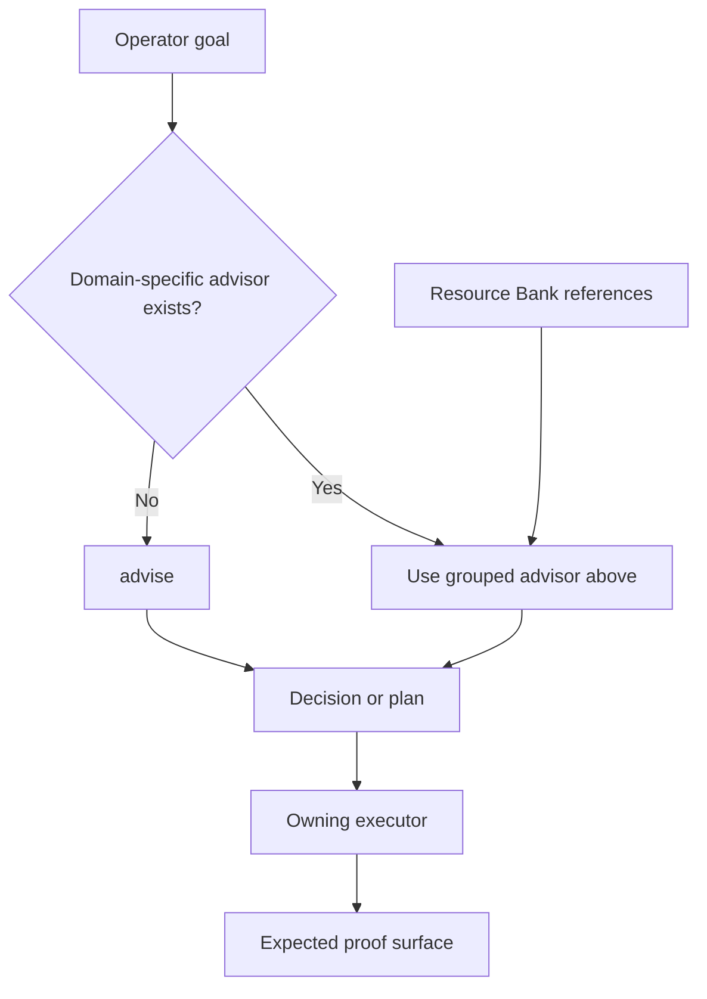

# Advisor System Index

The Advisor System is Farplane's decision-and-routing layer. An advisor turns
an under-specified goal into a recommendation, plan, configuration, or explicit
handoff to the skill that executes the work.

```text
advisor(goal, context, constraints) -> decision_or_plan + handoff + proof_expectation
```

This page is the human index. The generated
[`registry.jsonl`](registry.jsonl) and each linked `SKILL.md` remain the source
of truth for which skills exist and what they do.

## Inventory Rule

The current family contains:

- every active skill whose canonical name ends in `-advisor`; and
- `advise`, the foundational recommendation
  primitive used when no domain-specific advisor owns the decision.

As of 2026-10-12 (after the #41 unit merges), that is 5 named advisor packages plus `advise`: 6 entries.

## Choose By Use Case

### Decide, prioritize, and measure

| Need | Advisor | Produces |
| --- | --- | --- |
| Compare viable options and recommend one | [`advise`](../../skills/advise/SKILL.md) | Three options, tradeoffs, one recommendation, and next action, or a phased roadmap (`mode: roadmap`) whose first proof is a completed loop; `ensemble=auto|max` adds independent local perspectives when requested |
| Define honest success, guardrails, and failure signals | [`goal-advisor` metric card](../../skills/goal-advisor/references/metrics.md) | Metric card, guard metrics, anti-metrics, and route hint |

### Shape projects and harness execution

| Need | Advisor | Produces |
| --- | --- | --- |
| Decide where a Farplane behavior or capability belongs | [`harness`](../../skills/harness/SKILL.md) | Owner-surface recommendation across policy, skills, agents, hooks, tickets, docs, and validators |
| Compile material work into the right execution loop | [`goal-advisor`](../../skills/goal-advisor/SKILL.md) | Goal architecture, ticket-backed state, and native Goal prompt when warranted |
| Initialize or migrate a project into Farplane | [`setup-advisor`](../../skills/setup-advisor/SKILL.md) | Substrate/readiness audit, optional scaffold, and harness handoff |
| Define project-owned recurring Codex work | [`automation-advisor`](../../skills/automation-advisor/SKILL.md) | Automation configuration using Pulse and Interval workflows |

### Plan proof and durable documentation

| Need | Advisor | Produces |
| --- | --- | --- |
| Decide how a behavior claim should be proved | [`eval`](../../skills/eval/SKILL.md) | Proof cases, proof-surface choice, and eval rows or a QA/review handoff |
| Place, write, or revise durable documentation | [`doc-advisor`](../../skills/doc-advisor/SKILL.md) | Docs strategy or grounded doc delta with quality checks |

### Produce creative assets and video

The Marketing unit hands out one skill per deliverable. `storyboard` plans a
video or content piece end to end (production plan on the GitHub issue, hook
and script, scene asset plan, timed edit direction); generation skills return
accepted media; the external `hyperframes` skill composes and renders.

```text
Storyboard (plan -> script -> assets -> edit)
├── AI Image -> inspected image asset (create, edit, product, infographic, collage)
├── AI Video -> inspected clip, avatar clip, or audio file (voice, music, SFX)
├── Meshy 3D Generation -> 3D model, rig, or animation
├── HyperFrames (external) -> composed timeline + rendered video
└── Review / QA -> independent readiness evidence
```

Storyboard's asset plan picks reuse, source, or generation for each scene
asset; the generation skills run only after that choice.

| Need | Skill | Produces |
| --- | --- | --- |
| Plan a video, reel, or content piece | [`storyboard`](../../skills/storyboard/SKILL.md) | Hook decision, script, scenes, asset plan, edit direction, and HyperFrames handoff |
| Create, edit, upscale, or cut out images, product shots, infographics, or collages | [`ai-image`](../../skills/ai-image/SKILL.md) | Provider route, prompt, spend quote, and saved image asset |
| Generate clips, avatar/presenter video, voice, music, or SFX | [`ai-video`](../../skills/ai-video/SKILL.md) | Provider route, prompt, spend quote, and saved clip or audio file |
| Generate, texture, rig, or animate 3D assets | [`meshy-3d-generation`](../../skills/meshy-3d-generation/SKILL.md) | Meshy model files and credit receipt |

### Market and communicate

| Need | Skill | Produces |
| --- | --- | --- |
| Plan, launch paused, or report on paid ads | [`ads`](../../skills/ads/SKILL.md) | One-variable campaign plan, paused/draft launch handoff, or read-only report |
| Write page or SEO article copy, or a final-pass rewrite | [`copywriting`](../../skills/copywriting/SKILL.md) | Page copy, article, or cleaned prose that keeps every fact |
| Draft posts, threads, carousels, or newsletter issues | [`social-content`](../../skills/social-content/SKILL.md) | Approval-ready drafts; posting stays with `zernio` |
| Specify a landing page | [`landing-page`](../../skills/landing-page/SKILL.md) | Approved offer, story, section, asset, motion, and proof spec |

## Boundaries

Use these ownership rules to avoid creating duplicate advisors:

| Surface | Owns | Does not own |
| --- | --- | --- |
| Resource Bank | Source media and reusable creative patterns: description, why, example, and conditioning recipe | Branching, tool use, gates, or executable workflow |
| Advisor | Selection, constraints, compatibility, configuration, and the handoff contract | Permanent storage for every source artifact |
| Advisor method | A reusable branch inside one advisor, such as visual camera control inside AI Video | A new top-level identity before independent callers prove the split |
| Executor | Rendering, generation, testing, publishing, or another concrete side effect | The upstream decision when an advisor is required |

Use the terms consistently:

```text
Creative Element = reusable creative pattern
goldenRecipe = conditioning recipe
skill method = executable agent procedure
```

A Creative Element is data supplied to a skill. A method tells the agent how
to reason, branch, call tools, handle failure, and prove the result.

## Lean-boundary scorecard

Use three raw counts; do not combine them into a synthetic simplicity score:

- `owner_collision_count`: canonical decisions authored by more than one
  sibling owner. Target `0`.
- `avoidable_handoff_count`: mandatory handoffs that produce no distinct
  artifact, decision, side effect, or proof. Target `0`.
- `cold_route_accuracy`: representative requests routed correctly from
  first-load contracts without corrective explanation. Target `5/5` for the
  content-production calibration set.

An orchestrator may aggregate a child result without becoming its second
author. A parent may order a child action without re-deciding the child's
domain result.

Promote a method into a new advisor only when it has a stable independent
trigger, distinct inputs and outputs, repeated callers, and an ownership boundary
that no existing advisor can carry cleanly.

## Selection Flow



## Maintenance

When an advisor is added, renamed, or removed:

1. Change the owning `skills/<name>/SKILL.md` package first.
2. Regenerate [`registry.jsonl`](registry.jsonl).
3. Update the relevant use-case table on this page.
4. Verify that every `*-advisor` registry row appears exactly once and that no
   retired advisor remains linked.
5. Run the skill-registry and documentation reference validators.

Do not add a second hand-authored machine registry here. The grouping is an
editorial reader aid; package metadata and the generated registry remain
canonical inventory.
