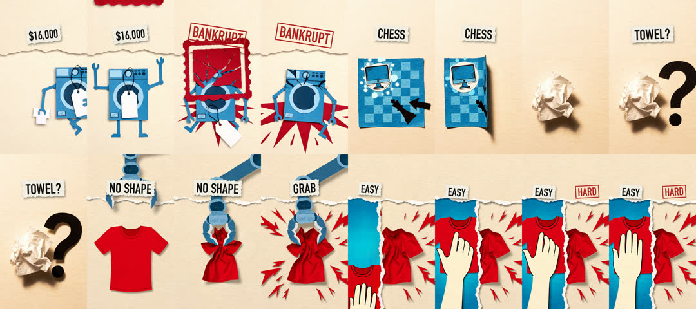
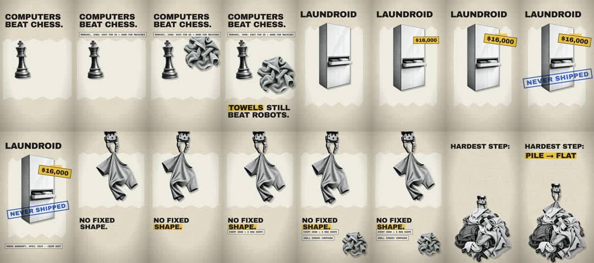
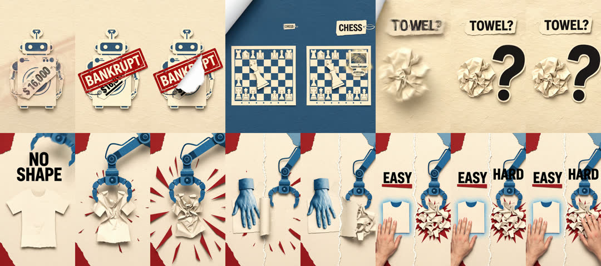

# Laundry-robot explainer: three routes, one brief

## Request

Faceless 9:16 explainer, about 16 s: why robots still can't fold laundry.
Facts (N2): Laundroid, a $16,000 folding robot, never shipped and its maker
went bankrupt in 2019; Moravec's 1988 paradox; cloth changes shape on every
grab.

## Script (N3)

```text
A sixteen-thousand-dollar laundry robot went bankrupt.   | fails      | robot cracks, tips over     | $16,000, BANKRUPT
Computers beat chess decades ago.                         | beats      | paper king falls flat       | CHESS
So why can't they fold a towel?                           | unknown    | crumpled ball + question mark | TOWEL?
Because cloth has no shape.                               | won't hold | shirt outline re-cuts itself | NO SHAPE
Every grab changes it.                                    | grabbed    | gripper lifts, shirt crumples | GRAB
What's easy for you is hardest for a robot.               | easy/hard  | vertical tear: fold vs heap  | EASY, HARD
must_hear: ["$16,000"]
```

## Trace (N4-N6)

1. One Gemini TTS take, plain text: 14.4 s, transcript matched except one filler word (0.91). (A first take
   with "Read this like a calm narrator:" in the text spoke the cue aloud.)
2. Windows on sentence ends: 0-3.8 s (line 1), 3.8-8.55 s (lines 2-3),
   8.55-15.6 s (lines 4-6) -> Veo silent clips of 6, 8 and 6 s, retimed 1.58x,
   1.68x and 0.85x.
3. Raw sheets: no text, paper hand, king topples. Labels placed on their words.
4. `vox_assemble.py plan.json` -> 15.6 s final, transcript pass (0.91), $2.01.



## What lost, and why

**Old route** (storyboard documentary reel + newsprint + ai-image cut-outs +
HyperFrames layers, $0.20): accurate and clean, but entrances and drift only;
it read as animated slides.



**Upstream method** (Veo with narration and labels baked in, 2 × 8 s, $2.40):
strong paper motion, but the narrator said "$6,000" for $16,000 (heard the
same way on two transcriptions), a photographed human hand appeared in the
last beat, and the two clips' voices differed (median pitch 183 vs 168 Hz).
`vox_assemble.py`'s must-hear check fails this take.



## Second run

A fresh agent given only this skill made "why ice is slippery" (15 s, $2.41,
about 10 minutes). It rejected one clip for stray "10" digits on a thermometer
and noticed a boot that changed colour between clips; both became craft rules.
Its N7 review then returned TAS-B: the hook ("You slip on water") and the last
line went beyond the cited sources, the thermometer filled red on "minus 38",
and the boot change had slipped through. Script claims must stay inside
brief.md, and visuals must not contradict the spoken meaning.
